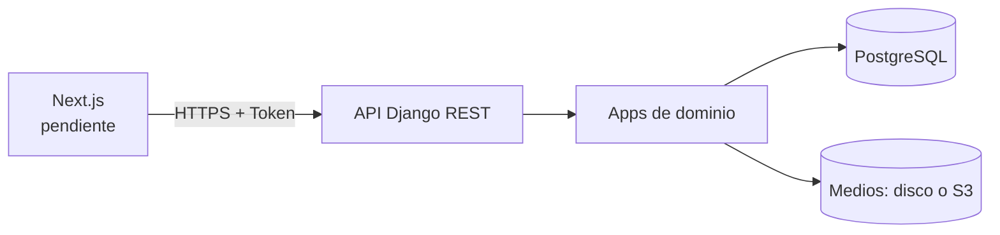

# Arkane Zone

Sistema de gestión para una tienda de videojuegos. El proyecto está organizado como un **monorepo** con dos aplicaciones independientes:

| Carpeta | Aplicación | Estado |
|---|---|---|
| [`backend/`](backend/README.md) | API REST en Django 5.2 + Django REST Framework | Funcional |
| [`frontend/`](frontend/README.md) | Aplicación Next.js (interfaz de usuario) | Pendiente de implementación |

El backend es **exclusivamente una API JSON**: no contiene plantillas, archivos estáticos, HTMX, Tailwind ni panel administrativo de Django. Toda la interfaz de usuario vivirá en la aplicación Next.js.

## Estructura del repositorio

```text
arcakane-zone/
├── backend/                 # API Django (sin frontend)
│   ├── arkane_zone/         # Configuración: settings, urls, permisos, health
│   ├── catalogo/            # Catálogo de videojuegos (API)
│   ├── cuentas/             # Usuarios, roles y autenticación por token
│   ├── pedidos/             # Carrito, pedidos y cancelación
│   ├── pagos/               # Pago simulado y ventas
│   ├── reportes/            # Reportes JSON para staff
│   ├── soporte/             # Contacto y solicitudes de información
│   ├── tests/               # Suite de pruebas con pytest
│   ├── manage.py
│   ├── requirements.txt
│   ├── requirements-dev.txt
│   ├── pytest.ini
│   ├── build.sh
│   └── .env.example
├── frontend/                # Aplicación Next.js (pendiente)
│   └── README.md
├── docs/                    # Auditoría, plan de sprint y diagramas
├── render.yaml              # Blueprint de Render (rootDir: backend)
├── .gitignore
└── README.md
```

## Tecnologías

| Capa | Tecnología |
|---|---|
| Backend | Python 3.12, Django 5.2, Django REST Framework 3.18 |
| Autenticación | TokenAuthentication de DRF (`Authorization: Token <token>`) |
| Base de datos | PostgreSQL (`psycopg2`) vía `DATABASE_URL`; SQLite para pruebas |
| Servidor | Gunicorn |
| Almacenamiento de medios | Sistema de archivos local o S3 compatible (`boto3`, `django-storages`) |
| CORS | `django-cors-headers` para el origen de Next.js |
| Pruebas | Pytest + pytest-django |
| Despliegue | Render (`render.yaml`, `build.sh`) |
| Frontend objetivo | Next.js (pendiente) |

## Inicio rápido

### Backend

```bash
cd backend
python -m venv .venv
source .venv/bin/activate        # Windows: .venv\Scripts\activate
pip install -r requirements.txt
cp .env.example .env             # completar SECRET_KEY y DATABASE_URL
python manage.py migrate
python manage.py seed_catalogo
python manage.py runserver
```

La API queda disponible en `http://127.0.0.1:8000/api/v1/` y el health check en `http://127.0.0.1:8000/api/health/`.

Instrucciones detalladas, variables de entorno, endpoints, ejemplos y despliegue: [`backend/README.md`](backend/README.md).

### Frontend

La aplicación Next.js todavía no existe. La carpeta [`frontend/`](frontend/README.md) contiene el estado, la estructura propuesta y el contrato de API que consumirá.

## Arquitectura



El backend concentra el modelo de datos, las reglas de negocio, la autenticación y la lógica de catálogo, carrito, pedidos, pagos, reportes y soporte. El frontend consumirá esa lógica únicamente a través de la API JSON.

## Endpoints principales

| Prefijo | Descripción |
|---|---|
| `/api/health/` | Health check para Render |
| `/api/v1/auth/` | Registro, login, logout, perfil y cambio de contraseña |
| `/api/v1/catalogo/` | Videojuegos, categorías, plataformas y géneros |
| `/api/v1/pedidos/` | Carrito, historial, detalle y cancelación |
| `/api/v1/pagos/` | Checkout y pago simulado |
| `/api/v1/reportes/` | Dashboard y reportes (solo staff) |
| `/api/v1/soporte/` | Contacto, solicitud de información y bandeja de contactos |

## Despliegue

El servicio se despliega en **Render** usando el blueprint [`render.yaml`](render.yaml):

- `rootDir: backend` — Render ejecuta el build y el start dentro de `backend/`.
- Build: `./build.sh` (instala dependencias y ejecuta `migrate`).
- Start: Gunicorn con 2 workers y timeout de 120 s.
- Health check: `/api/health/`.
- Variables sensibles (`SECRET_KEY`, `DATABASE_URL`, `ALLOWED_HOSTS`, `CORS_ALLOWED_ORIGINS`): se configuran manualmente en el panel de Render, nunca en el repositorio.

## Documentación

- [API del backend](backend/README.md)
- [Frontend Next.js (pendiente)](frontend/README.md)
- [Auditoría inicial del repositorio](docs/audit/INITIAL-AUDIT.md)
- [Plan del Sprint 1](docs/sprints/SPRINT-1.md)
- [Diagrama de clases](docs/Diagrama%20de%20clases.drawio.png)
- [Diagrama entidad-relación](docs/Diagrama%20entidad%20relaci%C3%B3n%20drawio.png)

## Convenciones

- No subir archivos `.env` ni credenciales. Usar `backend/.env.example` como plantilla.
- El backend no debe contener HTML, templates, CSS ni lógica de presentación.
- Las reglas de negocio viven en el backend; el frontend no debe duplicarlas.
- Los cambios de infraestructura, modelo de datos o configuración de producción deben revisarse con el equipo.
- Las pruebas del backend se ejecutan con `pytest`; ver [`backend/README.md`](backend/README.md).

## Rama de trabajo

Esta reorganización se desarrolla en la rama:

```text
refactor/AZ-S1-21-backend-frontend
```

Issue relacionado: **AZ-S1-21 — Separar frontend y backend**.

## Autor

Miguel Angel Herrera Lujan — [@MiguelH](https://github.com/MiguelH)
