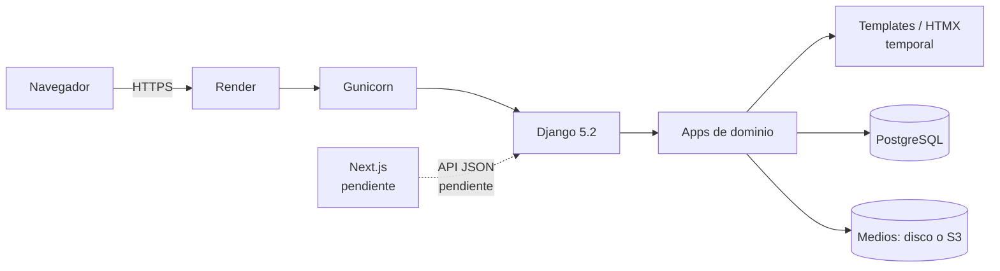

# Arkane Zone

Sistema de gestión para una tienda de videojuegos. El proyecto está organizado como un **monorepo** con dos aplicaciones independientes:

| Carpeta | Aplicación | Estado |
|---|---|---|
| [`backend/`](backend/README.md) | Aplicación Django 5.2 (dominio, administración y base de datos; API JSON planificada) | Funcional |
| [`frontend/`](frontend/README.md) | Aplicación Next.js (interfaz de usuario) | Pendiente de implementación |

> **Nota de transición:** hoy el backend sigue sirviendo la interfaz con Django Templates + HTMX para no romper la aplicación existente. Cuando se implemente el frontend en Next.js, esa interfaz se reemplazará por una API JSON. La carpeta `backend/templates/` es, por tanto, temporal.

## Estructura del repositorio

```text
arcakane-zone/
├── backend/                 # Aplicación Django
│   ├── arkane_zone/         # Configuración del proyecto (settings, urls, wsgi/asgi)
│   ├── catalogo/            # Catálogo de videojuegos
│   ├── cuentas/             # Usuarios, roles y autenticación
│   ├── pedidos/             # Carrito, pedidos y cancelación
│   ├── pagos/               # Pago simulado y ventas
│   ├── reportes/            # Dashboard y reportes
│   ├── soporte/             # Contacto y ayuda
│   ├── templates/           # Interfaz Django temporal (se reemplazará con Next.js)
│   ├── tests/               # Suite de pruebas con pytest
│   ├── manage.py
│   ├── requirements.txt
│   ├── pytest.ini
│   ├── build.sh
│   └── .env.example
├── frontend/                # Aplicación Next.js (pendiente)
│   └── README.md
├── docs/                    # Auditoría, plan de sprint y diagramas
├── render.yaml              # Blueprint de Render (rootDir: backend)
├── .gitignore
└── README.md
```

## Tecnologías

| Capa | Tecnología |
|---|---|
| Backend | Python 3.12, Django 5.2, django-environ, django-unfold |
| Base de datos | PostgreSQL (`psycopg2`) vía `DATABASE_URL`; SQLite para pruebas |
| Servidor / estáticos | Gunicorn, WhiteNoise |
| Almacenamiento de medios | Sistema de archivos local o S3 compatible (`boto3`, `django-storages`) |
| Frontend actual | Django Templates, Tailwind CSS (CDN), HTMX 2.0.4 |
| Frontend objetivo | Next.js (pendiente) |
| Pruebas | Pytest + pytest-django |
| Despliegue | Render (`render.yaml`, `build.sh`) |

## Inicio rápido

### Backend

```bash
cd backend
python -m venv .venv
source .venv/bin/activate        # Windows: .venv\Scripts\activate
pip install -r requirements.txt
cp .env.example .env             # completar SECRET_KEY y DATABASE_URL
python manage.py migrate
python manage.py seed_catalogo
python manage.py createsuperuser
python manage.py runserver
```

La aplicación queda disponible en `http://127.0.0.1:8000/` y el admin en `http://127.0.0.1:8000/admin/`.

Instrucciones detalladas, variables de entorno, pruebas y despliegue: [`backend/README.md`](backend/README.md).

### Frontend

La aplicación Next.js todavía no existe. La carpeta [`frontend/`](frontend/README.md) contiene la propuesta de estructura, convenciones y pasos de integración para el siguiente issue.

## Arquitectura



El backend concentra las reglas de negocio, el modelo de datos, la autenticación, el panel administrativo y la lógica de pedidos/pagos. El frontend futuro consumirá esa lógica a través de una API; la estrategia de autenticación y el contrato de la API se definirán antes de implementar Next.js.

## Despliegue

El servicio se despliega en **Render** usando el blueprint [`render.yaml`](render.yaml):

- `rootDir: backend` — Render ejecuta el build y el start dentro de `backend/`.
- Build: `./build.sh` (instala dependencias, ejecuta `collectstatic` y `migrate`).
- Start: Gunicorn con 2 workers y timeout de 120 s.
- Estáticos: WhiteNoise.
- Variables sensibles (`SECRET_KEY`, `DATABASE_URL`, `ALLOWED_HOSTS`): se configuran manualmente en el panel de Render, nunca en el repositorio.

## Documentación

- [Auditoría inicial del repositorio](docs/audit/INITIAL-AUDIT.md)
- [Plan del Sprint 1](docs/sprints/SPRINT-1.md)
- [Diagrama de clases](docs/Diagrama%20de%20clases.drawio.png)
- [Diagrama entidad-relación](docs/Diagrama%20entidad%20relaci%C3%B3n%20drawio.png)

## Convenciones

- No subir archivos `.env` ni credenciales. Usar `backend/.env.example` como plantilla.
- Los cambios de infraestructura, modelo de datos o configuración de producción deben revisarse con el equipo.
- Las pruebas del backend se ejecutan con `pytest`; ver las limitaciones actuales en [`backend/README.md`](backend/README.md).
- Los hallazgos y decisiones del Sprint 1 se documentan en `docs/`.

## Rama de trabajo

Esta reorganización se desarrolla en la rama:

```text
refactor/AZ-S1-21-backend-frontend
```

Issue relacionado: **AZ-S1-21 — Separar frontend y backend**.

## Autor

Miguel Angel Herrera Lujan — [@MiguelH](https://github.com/MiguelH)
